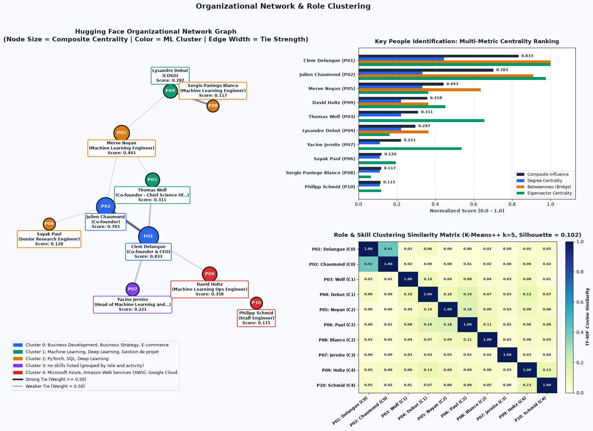
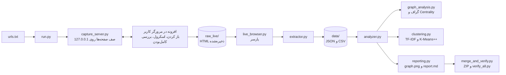

<div dir="rtl">

# 🔗 تحلیل گراف و یادگیری ماشین پروفایل‌های لینکدین


پاسخ مرحله‌ی آزمایشی موقعیت **متخصص هوش مصنوعی** موسسه Cyberyan.

پروژه پروفایل‌های فهرست‌شده در `urls.txt` را از لینکدین استخراج و در قالب JSON و DataFrame ذخیره می‌کند. بعد سه تحلیل روی آن‌ها اجرا می‌کند: گراف ارتباطی افراد، شناسایی افراد کلیدی با Centrality، و خوشه‌بندی نقش‌ها و مهارت‌ها.

**فهرست:** [نتایج کلیدی](#نتایج-کلیدی) · [شروع سریع](#شروع-سریع) · [معماری](#معماری) · [منبع داده‌ها](#منبع-داده‌ها-و-روش-تهیه) · [منطق تحلیل](#منطق-تحلیل) · [تست‌ها](#تست‌ها) · [ساختار پروژه](#ساختار-پروژه)

## نتایج کلیدی

داده‌ی فعلی: ۱۰ عضو Hugging Face، شامل هم‌بنیان‌گذاران، تیم متن‌باز و یک عضو سابق که حالا در Google DeepMind است.

| | |
| :--- | :--- |
| 📥 **حجم استخراج** | ۶۴ سابقه‌ی شغلی، ۳۱ سابقه‌ی تحصیلی، ۲۶۵ مهارت، ۸۴ علاقه، ۱۸۸ فعالیت |
| 🕸️ **گراف** | ۱۰ نفر، ۱۰ یال، چگالی ۰٫۲۲. همه‌ی یال‌ها از تعامل واقعی (منشن و بازنشر) بین افراد فهرست می‌آیند |
| ⭐ **فرد کلیدی** | **Clem Delangue** (مدیرعامل)، امتیاز ترکیبی ۰٫۸۳ و پل اصلی (Betweenness = ۱)، با هر سه تعریف فاصله |
| 🥈 **رتبه‌ی دوم** | **Julien Chaumond** (مدیر فنی)، امتیاز ۰٫۷۰. قوی‌ترین یال گراف بین این دو هم‌بنیان‌گذار است |
| 🧩 **خوشه‌ها** | مدیریت و کسب‌وکار (Clem، Julien) · پژوهش یادگیری ماشین (Thomas، Lysandre) · یادگیری عمیق و ابزار (Merve، Sayak، Sergio) · زیرساخت ابری (David، Philipp) · Yacine جدا، چون مهارتی ثبت نکرده است |
| ✅ **صحت** | تعداد مهارت‌های هر نفر با عددی که خود لینکدین در عنوان «Skills (N)» نشان می‌دهد برابر است |
| ⚠️ **محدودیت** | Silhouette برابر ۰٫۱۰ است، پس خوشه‌ها گرایش کلی‌اند نه مرز قطعی. با ۱۰ نفر نتیجه‌ها آماری نیستند |



گزارش کامل با همه‌ی جدول‌ها در [output/report.md](output/report.md) است.

## شروع سریع

### بررسی بدون لینکدین (پیشنهاد برای ارزیابی)

داده‌ی استخراج‌شده و خروجی‌ها همراه پروژه هستند، پس تحلیل و همه‌ی تست‌ها بدون حساب لینکدین اجرا می‌شوند:

```bash
pip install -r requirements.txt
python verify_all.py       # همه‌ی تست‌ها؛ در آخر GLOBAL_VERDICT: PASS
python src/analyzer.py     # ساخت دوباره‌ی output/ از data/
```

### استخراج تازه از لینکدین

**پیش‌نیاز:** Python (آزموده‌شده با 3.13)، و Chrome یا Brave که در آن وارد لینکدین شده‌اید.

**۱. نصب افزونه (فقط یک‌بار):**
1. در Chrome یا Brave، `chrome://extensions` را باز کنید.
2. Developer mode را روشن کنید.
3. Load unpacked را بزنید و پوشه‌ی `browser_extension` را انتخاب کنید.

**۲. اجرا:**

```bash
./start.sh
```

**نحوه اجرا** در همین یک دستور خلاصه می‌شود. بار اول محیط پایتون ساخته و وابستگی‌ها نصب می‌شوند. بعد پروفایل‌های `urls.txt` خوانده، تحلیل و بسته‌بندی می‌شوند و همه‌ی تست‌ها اجرا می‌شوند. در ویندوز، پس از `pip install -r requirements.txt` دستور `python run.py` را بزنید.

صفحه‌ی پیشرفت روی `http://127.0.0.1:8765/` باز می‌شود. پنجره‌ای را که افزونه باز می‌کند کوچک نکنید: لینکدین هر بخش را فقط وقتی روی صفحه دیده شود بار می‌کند. برای ۱۰ پروفایل (۶۰ صفحه) حدود ۱۲ دقیقه طول می‌کشد.

<details>
<summary><b>دستورهای دیگر</b></summary>

```bash
python run.py --urls other.txt           # فایل دیگری از لینک‌ها، با هر تعداد پروفایل (حداقل ۲)
python run.py analyze                    # پارس و تحلیل دوباره‌ی صفحه‌های ذخیره‌شده در raw_live/
python src/extractor.py --mode offline   # داده‌ی نمونه‌ی ساختگی، بدون اینترنت
python verify_all.py                     # همه‌ی بررسی‌ها؛ کد خروج 0 یعنی موفق
```

در `urls.txt` هر خط یک نشانی است. شماره‌ی ابتدای خط، پارامترهای نشانی و خط تکراری نادیده گرفته می‌شوند.

</details>

## معماری



**چرا افزونه‌ی مرورگر و نه یک اسکریپت ساده؟** لینکدین صفحه‌ی کامل پروفایل را بدون ورود نشان نمی‌دهد و به درخواست HTTP مستقیم پاسخ `999` یا Authwall می‌دهد. پس یک اسکریپت ساده‌ی `requests` داده‌ی واقعی برنمی‌گرداند. افزونه صفحه‌ها را در همان مرورگری می‌خواند که کاربر در آن وارد شده است:
- **پنهان‌کاری ندارد:** اتوماسیون را پنهان نمی‌کند، هویت مرورگر را تغییر نمی‌دهد و چالش امنیتی را حل نمی‌کند.
- **فاصله‌ی زمانی:** بین صفحه‌ها ۵ تا ۹ ثانیه صبر می‌کند.
- **توقف و ادامه:** با اولین Checkpoint یا صفحه‌ی ورود متوقف می‌شود. صفحه‌های ذخیره‌شده می‌مانند و اجرای بعدی از همان‌جا ادامه می‌دهد.
- **حریم خصوصی:** اسکریپت‌ها و تصاویر را پیش از ذخیره حذف می‌کند و چیزی جز به سرور محلی پروژه نمی‌فرستد.

شرایط استفاده‌ی لینکدین اتوماسیون را محدود می‌کند و تصمیم استفاده از حساب با اجراکننده است.

## منبع داده‌ها و روش تهیه

| منبع | توضیح |
| :--- | :--- |
| صفحه‌های واقعی لینکدین | شش صفحه برای هر نفر (اصلی، سوابق، تحصیلات، مهارت‌ها، علایق، Activity)، خوانده‌شده با افزونه و ذخیره‌شده در `raw_live/` |
| نمونه‌ی ساختگی | `sample_data/synthetic_profiles.json`، یک سازمان فرضی ۱۰ نفره برای اجرای بدون اینترنت و تست‌ها |

- **برچسب منبع:** هر رکورد فیلد `data_source` دارد (`live` یا `synthetic_sample`). گزارش و نمودار، نمونه‌بودن داده را اعلام می‌کنند.
- **بدون حدس:** فیلدی که در صفحه نیست `null` می‌شود. بخشی که پیدا نشود در `missing_sections` و در گزارش می‌آید.
- **پارسر مقاوم:** لینکدین نام کلاس‌ها را رمزگذاری می‌کند، پس پارسر بر عنوان هر بخش، ویژگی `componentkey` و ترتیب خطوط تکیه دارد. شرکت‌ها و دانشگاه‌ها با شناسه‌ی لینکشان مقایسه می‌شوند، پس «Google» و «谷歌» یکی است.
- **صفحه‌ی ناقص:** صفحه‌ای که پیش از بارگذاری کامل ذخیره شده باشد، یا فهرستی که از عدد خود لینکدین کوتاه‌تر باشد، خودکار دوباره درخواست می‌شود.
- **حریم خصوصی:** `raw_live/` صفحه‌های کامل را دارد و نه وارد ZIP می‌شود و نه وارد ریپو. `data/` و `output/` داده‌ی افراد واقعی را دارند.

| خروجی | محتوا |
| :--- | :--- |
| `data/profiles.json` | رکورد کامل هر نفر: اطلاعات پایه، سوابق شغلی و تحصیلی، مهارت‌ها، علایق، Activity |
| `data/profiles_summary.csv` | DataFrame خلاصه، یک سطر برای هر نفر |
| `data/activities_df.csv` | DataFrame فعالیت‌ها، یک سطر برای هر پست یا تعامل |
| `output/graph.json` | گره‌ها، یال‌ها، رتبه‌بندی Centrality و خوشه‌ها |
| `output/graph.png` | گراف، مقایسه‌ی شاخص‌ها و ماتریس شباهت |
| `output/report.md` | گزارش تحلیلی فارسی |

## منطق تحلیل

1. **گراف ارتباطی:** وزن هر یال ترکیبی از چهار چیز است: تعامل در Activity، شرکت فعلی یا قبلی مشترک، شباهت مهارت (پس از یکسان‌سازی نام‌ها) و دانشگاه مشترک. هم‌سازمان بودن به‌تنهایی یال نمی‌سازد تا گراف کامل نشود و تفاوت افراد دیده شود.
2. **افراد کلیدی:** چهار شاخص Degree، Betweenness، Eigenvector و PageRank در یک امتیاز ترکیبی جمع می‌شوند. پایداری نتیجه با سه تعریف فاصله بررسی می‌شود.
3. **خوشه‌بندی:** بردارهای TF-IDF از مهارت‌ها، نقش و هشتگ‌ها با K-Means++ خوشه‌بندی می‌شوند و k با بیشینه‌کردن Silhouette انتخاب می‌شود.

فرمول‌ها، فرضیات، طراحی HTTP و Rate Limiting، صف Redis/Kafka و ذخیره‌سازی در مقیاس بزرگ در [notes.md](notes.md) آمده‌اند.

## تست‌ها

`python verify_all.py` شش بررسی را اجرا می‌کند و ZIP را هم با فایل‌های پروژه مقایسه می‌کند:

| تست | چه چیزی را می‌سنجد |
| :--- | :--- |
| `test_unit_1.py` | پارسر روی HTML نمونه به سبک لینکدین، عدم حدس مقادیر، ساختار JSON و CSV |
| `test_unit_2.py` | محدوده‌ی شاخص‌ها، انتخاب k، مستقل‌بودن نتیجه از ترتیب ورودی، صحت متن گزارش |
| `test_capture.py` | صف، ادامه پس از قطع، امنیت نوشتن فایل، توکن، توقف در Checkpoint |
| `test_real_data.py` | روی داده‌ی واقعی: برابری تعداد مهارت‌ها با عدد لینکدین، پوشش بخش‌ها، سلامت گراف، هماهنگی README با تحلیل |
| `test_docs.py` | کامل‌بودن README و notes.md |

## ساختار پروژه

```text
start.sh, run.py           نقطه‌ی شروع: از urls.txt تا ZIP
urls.txt                   فهرست پروفایل‌ها
browser_extension/         افزونه‌ی خواندن صفحه‌ها در مرورگر کاربر
src/capture_server.py      سرور محلی صف صفحه‌ها
src/live_browser.py        پارس صفحه‌های ذخیره‌شده‌ی لینکدین
src/extractor.py           ذخیره‌ی JSON و DataFrame (و بارگذاری نمونه‌ی ساختگی)
src/analyzer.py            هماهنگ‌کننده‌ی تحلیل
src/graph_analysis.py      گراف وزن‌دار و Centrality
src/clustering.py          یکسان‌سازی مهارت‌ها، TF-IDF و K-Means++
src/reporting.py           graph.png و report.md
src/merge_and_verify.py    بررسی یکپارچگی خروجی‌ها و ساخت ZIP
sample_data/               داده‌ی نمونه‌ی ساختگی
tests/, verify_all.py      بررسی‌های خودکار
```

</div>
